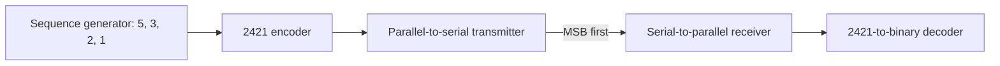

# 2421 Serial Communication System

**Additional submission files and evidence:** see [Drive submission and evidence](docs/drive-evidence.md) for the separately preserved Drive circuit/report snapshot and available recordings or captures.

A Proteus digital-logic project for generating the repeating decimal sequence **5 → 3 → 2 → 1**, encoding each digit in **2421 BCD**, transmitting it serially, and reconstructing the original digit at the receiver.

**Status: work in progress.** The original report states that the circuit worked through the encoder, but the serial-input/parallel-output stage did not work correctly. End-to-end transmission and recovery have not been demonstrated. The circuit has not been rerun during repository preparation.

## Project files

| File | Purpose |
| --- | --- |
| [Proteus circuit](proteus/2421-serial-link.pdsprj) | Original circuit project, renamed for clarity |
| [Design report](docs/design-report.docx) | Sequence generation, encoding tables, design approach and recorded issues |

Both files preserve their original contents. This repository organizes the existing design and documents its current state.

## Intended signal path



Each digit occupies four bit-clock cycles. The sequence generator should advance only after all four bits of the current encoded digit have been transmitted.

| Digit | Binary input | 2421 code | Transmission order |
| --- | --- | --- | --- |
| 5 | `0101` | `1011` | 1, 0, 1, 1 |
| 3 | `0011` | `0011` | 0, 0, 1, 1 |
| 2 | `0010` | `0010` | 0, 0, 1, 0 |
| 1 | `0001` | `0001` | 0, 0, 0, 1 |

The target repeating serial stream is:

```text
1011 0011 0010 0001
```

This is the intended output, not a verified capture from the circuit.

## Current progress

| Block | Evidence and status |
| --- | --- |
| Sequence generation | State/output mapping is described in the report. A counter-wiring issue and its correction are recorded. |
| 2421 encoder | Encoding table and design approach are documented; the report describes operation through this stage. |
| Serial transfer and parallel reconstruction | Unresolved: the report records incorrect operation. |
| Decoded receiver output | End-to-end recovery is not verified. |

## Open and investigate

1. Open `proteus/2421-serial-link.pdsprj` in a compatible Proteus installation.
2. Initialize the counters and registers, then inspect the generated digit and encoder output independently.
3. Check the four transmitted bits against the table above, including MSB-first ordering.
4. Inspect the transmitter load/shift timing, receiver shift direction and four-bit word boundary.
5. Verify that the digit changes only after the complete current word is transmitted.
6. Once reconstruction works, check that the decoder recovers `5, 3, 2, 1` repeatedly and record simulation evidence.

These are debugging checkpoints, not established diagnoses. Tool version, clock configuration and component compatibility still need to be confirmed in simulation. Proteus software and vendor component libraries are not distributed here.

## Documentation note

The original report contains a few equation-label inconsistencies. For the sequence-generator state mapping `00 → 5`, `01 → 3`, `10 → 2`, `11 → 1`, the digit-output equations derived from its truth table are:

```text
D3 = 0
D2 = NOT S1 AND NOT S0
D1 = S1 XOR S0
D0 = NOT S1 OR S0
```

In particular, the report calls the D2 function NAND; the table corresponds to NOR of S1 and S0. The report is preserved unchanged, and the circuit wiring has not been altered to match these equations.

## Background

Originally developed for Spider Electronics as a navigation-core synchronization exercise. The repository is named after its sequence-encoding and serial-communication function.
